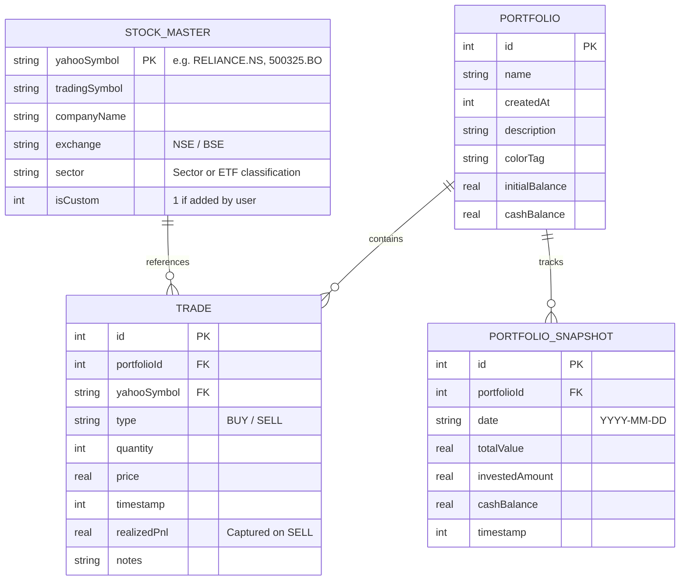

# 📈 PaperFolio — Indian Stock Market Paper Trading App

<div align="center">

[](https://developer.android.com/)
[](https://kotlinlang.org/)
[](https://developer.android.com/jetpack/compose)
[](https://m3.material.io/)
[](https://developer.android.com/training/data-storage/room)
[](LICENSE)

**A modern, self-contained, and completely serverless Android paper trading app for the Indian Stock Market (NSE & BSE Equities + ETFs).**

Inspired by the clean light UI of the **Dhan** app. Built for pure delivery/cash investing with **zero real money risk** and **100% free offline-first architecture**.

</div>

---

## 🌟 Why PaperFolio?

Most paper trading platforms either require paid subscriptions, mandate broker logins, clutter the interface with complex derivatives (F&O), or fail to provide a genuine Indian market experience with NSE and BSE equities.

**PaperFolio** is crafted to bridge that gap:
* 🇮🇳 **Pure Indian Market Focus**: Covers **8,100+ active NSE & BSE equities and 360+ ETFs**.
* 🛡️ **Pure Delivery / Cash Trading**: No options, no futures, no confusing leverage — practice disciplined long-term investing and swing trading.
* ⚡ **100% Free & Serverless**: No external server or recurring API costs. The app runs completely on-device using a pre-compiled SQLite database and free, on-demand live quotes.
* 🎨 **Dhan-Inspired Aesthetics**: Light palette (white background, hairline `#E5E8EB` borders), Inter typography, profit/loss as plain coloured text (`#007A5E` / `#D92D20`), custom cubic Bézier price charts, and performance range sliders.

---

## ✨ Features at a Glance

### 1. 💼 Multi-Portfolio Management
- Create multiple isolated portfolios (e.g. *Long Term Growth*, *High Dividend*, *Tech Basket*, *Penny Stocks*).
- Set customizable capital budgets at creation (**₹1,000 to Unlimited**).
- Dynamic cash balance deduction on buy, refund on sell.
- Color tags and individual portfolio net worth tracking.

### 2. ⚡ Offline Stock Search & On-Demand Quotes
- Instant search across **8,100+ instruments** with `< 1ms` latency, using `LIKE` prefix matching on the local catalog. (An FTS4 table is seeded alongside the catalog for future use, but search currently runs on `LIKE`, not FTS.)
- Dedicated filter chips: **ALL**, **NSE**, **BSE**, and **ETF** with custom exchange badges.
- **On-Demand Live Pricing**: The app does **not** fetch bulk quotes on startup. Live market prices and interactive charts are only fetched when you inspect a specific stock or view an active portfolio.

### 3. 📊 Interactive Charts & Dhan-Style Performance
- Custom Canvas chart featuring cubic Bézier smoothing, vertical gradient shading, dashed previous-close reference lines, and touch crosshairs with price tooltips.
- **Dhan Performance Sliders**: Instant visual indicators showing where the current price sits between **Today's Low / High** and **52-Week Low / High**.
- Time period selectors (**1D**, **5D**, **1M**, **6M**, **1Y**, **5Y**, **MAX**).

### 4. 🛒 Buy & Sell Delivery Orders
- **Averaged Position Tracking**: Multiple buy orders of the same stock automatically compute the weighted average buy price.
- **Quick Stepper & Presets**: Increment/decrement shares or tap quick preset chips (`+5`, `+10`, `+25`, `+50`).
- **Instant LTP Reset**: One tap to reset custom order prices back to the live Last Traded Price (LTP).
- **One-Tap "Sell All"**: Easily exit a holding completely or sell partial quantities with instant realized P&L estimation.

### 5. 📈 Comprehensive P&L Statement
- Total Net P&L dashboard with clear split between **Realized Gains** (from sold trades) and **Unrealized Gains** (from open holdings).
- Indian Currency formatting (`₹1,50,000.00` in Lakhs & Crores grouping).
- Quick time period filters: **1D | 1W | 1M | 6M | 1Y | 3Y | 5Y | ALL**.
- **Available History Scaling**: If a portfolio is younger than the selected filter (e.g. 1 week old, but 1Y is tapped), it intelligently renders the maximum historical data available.
- **Custom Date Range Picker**: Material 3 date range selector for custom tax-year or quarterly performance reviews.
- Portfolio breakdown cards and complete realized transaction history log.

### 6. 🆕 Add Newly Listed IPO Stocks
- Newly listed stock or IPO not in the bundled master catalog?
- Navigate to **Settings → Add New Listed Stock**, type the trading symbol (e.g., `SWIGGY`, `ZOMATO`), and the app validates it via live market feeds and registers it into your local offline database permanently.

### 7. ⏱️ Automated Daily Snapshots
- Powered by Android **WorkManager** to record a daily portfolio snapshot every 24 hours in the background for continuous historical net worth charting.

---

## 🏗️ Architecture & Tech Stack

PaperFolio follows Google's recommended **Clean Architecture** and **MVVM** pattern:

```
┌────────────────────────────────────────────────────────┐
│                      UI Layer                          │
│   Jetpack Compose · Material 3 · StateFlow · Coroutines│
└──────────────────────────┬─────────────────────────────┘
                           │
┌──────────────────────────▼─────────────────────────────┐
│                    Domain Layer                        │
│   Domain Models · Business Use Cases · Pure Kotlin     │
└──────────────────────────┬─────────────────────────────┘
                           │
┌──────────────────────────▼─────────────────────────────┐
│                     Data Layer                         │
│  Room DB (SQLite)  ·  Retrofit  ·  WorkManager  │
└────────────────────────────────────────────────────────┘
```

| Technology | Purpose |
|---|---|
| **Language** | Kotlin 1.9.24 |
| **UI Framework** | Jetpack Compose (BOM 2024.05.00) + Material 3 |
| **Navigation** | AndroidX Navigation Compose 2.7.7 |
| **Database** | Room 2.6.1 (SQLite; stock catalog seeded from the bundled asset — see [Data safety](#-data-safety-v102)) |
| **Networking** | Retrofit 2.11.0 + OkHttp 4.12.0 (Yahoo Finance v8 engine) |
| **Serialization** | Kotlinx Serialization JSON 1.6.3 |
| **Background Tasks** | AndroidX WorkManager 2.9.0 |
| **Currency** | Indian Financial Grouping System (`FormatUtils.kt`) |
| **Architecture** | MVVM with Repository Pattern & Reactive StateFlows |

---

## 🗄️ Database Schema



---

## 📁 Project Structure

```text
paper_trade/
├── app/
│   ├── src/main/
│   │   ├── assets/
│   │   │   └── stock_master.db          # Pre-compiled database (8,100+ stocks & ETFs)
│   │   ├── java/com/paperfolio/
│   │   │   ├── data/
│   │   │   │   ├── local/               # Room DB, DAOs, Entities
│   │   │   │   ├── remote/              # Retrofit API, Yahoo chart models
│   │   │   │   └── repository/          # Stock, Trade, Portfolio repositories
│   │   │   ├── domain/model/            # Pure domain models
│   │   │   ├── ui/
│   │   │   │   ├── components/          # StockLineChart, BottomSheets, Badges
│   │   │   │   ├── home/                # HomeScreen & HomeViewModel
│   │   │   │   ├── pnl/                 # PnlScreen & PnlViewModel
│   │   │   │   ├── portfolio/           # PortfolioDetailScreen & ViewModel
│   │   │   │   ├── search/              # StockSearchScreen & ViewModel
│   │   │   │   ├── settings/            # SettingsScreen & ViewModel
│   │   │   │   ├── theme/               # Dhan colors, typography, theme
│   │   │   │   └── utils/               # FormatUtils (Indian currency formatting)
│   │   │   ├── worker/                  # DailySnapshotWorker (WorkManager)
│   │   │   ├── MainActivity.kt          # Single-activity Compose NavHost
│   │   │   └── PaperFolioApp.kt         # Application class & lazy DI
│   │   └── res/                         # Icons, mipmaps, colors, themes
│   └── build.gradle.kts                 # App dependencies & signing config
├── tools/
│   ├── build_stock_db.py                # Python tool to fetch NSE/BSE & build stock DB
│   └── generate_icons.py                # Icon generator for all mipmap densities
├── build.gradle.kts                     # Root build file
├── settings.gradle.kts                  # Project settings
└── README.md                            # You are here!
```

---

## 🚀 Building & Running from Source

### Prerequisites:
* **JDK 17** (e.g. JetBrains Runtime / OpenJDK 17)
* **Android SDK** with build tools version `34.0.0`
* **Android Studio** (Hedgehog or newer recommended)

### 1. Clone the Repository:
```bash
git clone https://github.com/MetriSomesh/PaperFolio.git
cd PaperFolio
```

### 2. Configure Local Properties:
Create a `local.properties` file in the root folder pointing to your Android SDK:
```properties
sdk.dir=C\:\\Users\\<username>\\AppData\\Local\\Android\\Sdk
```

### 3. Build Signed Release APK:
```bash
./gradlew assembleRelease
```
The compiled signed release APK will be generated at:
```text
app/build/outputs/apk/release/app-release.apk
```

### 4. Install via ADB:
```bash
adb install -r app/build/outputs/apk/release/app-release.apk
```

---

## 🎨 Color Palette (Dhan Inspiration)

Dhan's app is light: white background, hairline borders, and colour used sparingly — green/red as plain text for P&L, a solid green fill only for the primary BUY action. Text contrasts were computed against their backgrounds (WCAG AA: 4.5:1 for body text).

| Color Name | Hex Code | Contrast | Purpose |
|---|---|---|---|
| **Background** | `#FFFFFF` | — | App background |
| **Surface Card** | `#FFFFFF` | — | Cards (1dp `#E5E8EB` border, no shadow) |
| **Surface Elevated** | `#F4F6F8` | — | Search bars, stepper buttons, chips |
| **Text Primary** | `#12151A` | 18.5:1 | Headings, values |
| **Text Secondary** | `#5B6675` | 5.8:1 | Labels, subtext |
| **Text Tertiary** | `#6B7686` | 4.6:1 | Captions, timestamps |
| **Brand Green** | `#00916E` | — | BUY fill, links, selected tabs |
| **Profit Green (text)** | `#007A5E` | 5.3:1 | Gains, P&L text |
| **Loss Red (text)** | `#D92D20` | 4.8:1 | Losses, SELL, errors |
| **Chart Green** | `#00B386` | — | Chart line / gradient |
| **BSE Violet** | `#7C3AED` | — | BSE badge |
| **ETF Amber** | `#B45309` | — | ETF badge |

## 🛡️ Data safety (v1.0.2)

**The bug (v1.0.1):** creating portfolios and adding stocks, then closing the app from Recents and reopening it, wiped every portfolio and trade.

**Root cause:** the database was built with `.createFromAsset("stock_master.db")` + `.fallbackToDestructiveMigration()`. The bundled asset shipped with `PRAGMA user_version = 0` while Room expected version 1, so on every cold (re)open Room's copy-helper saw a version mismatch with no migration path and **deleted the live database file and re-copied the asset** — user tables included. Two more wipe paths existed: the app-level catch that deleted the database on any open error, and the recovery screen's one-tap "Reset & Retry".

**The fix:**
- No `createFromAsset`, no destructive fallback. The stock catalog is now seeded from the asset with `ATTACH` + `INSERT OR IGNORE` into an ordinary Room database (`CatalogSeedCallback`), which only ever INSERTs into `stock_master` / `stock_master_fts` and can never touch user tables.
- If the catalog is ever found empty on open, it re-seeds itself (self-heal) — again without touching user data.
- Buy/sell and portfolio creation now run inside single Room transactions, so a crash mid-order can't leave a half-written state.
- The recovery screen's erase is now a deliberate two-tap action ("Tap again to erase ALL portfolios & trades").

**Regression test:** `app/src/test/java/com/paperfolio/PersistenceTest.kt` (Robolectric, runs on the JVM) simulates the exact user flow — create, insert, close, reopen, twice — and asserts portfolios, trades, and the 8,100-stock catalog all survive, plus that an emptied catalog self-heals without touching user data. Run it with `./gradlew testDebugUnitTest`.

---

## 📜 License

This project is licensed under the **MIT License** — feel free to modify, distribute, and build on top of it.

```text
MIT License

Copyright (c) 2026 Somesh Metri

Permission is hereby granted, free of charge, to any person obtaining a copy
of this software and associated documentation files (the "Software"), to deal
in the Software without restriction, including without limitation the rights
to use, copy, modify, merge, publish, distribute, sublicense, and/or sell
copies of the Software, and to permit persons to whom the Software is
furnished to do so, subject to the following conditions:
...
```

---

<div align="center">
Made with ❤️ for Indian Stock Market Investors
</div>
